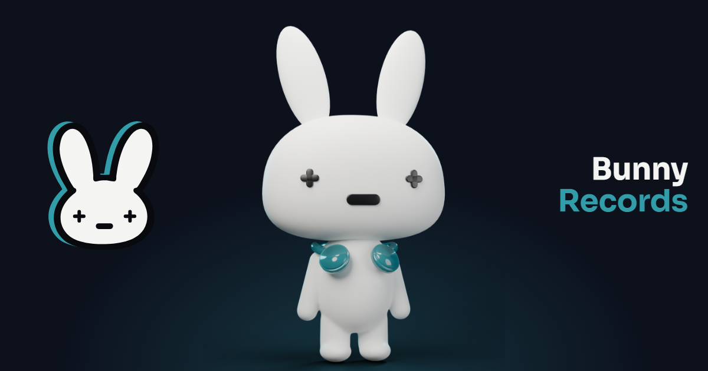

# Bunny Records

**[bunnyrecords.dev](https://bunnyrecords.dev)** · Portfolio de Antonio Garcia Romero, presentado como un sello discográfico: cada proyecto es un álbum, su caso de estudio son las pistas y las tecnologías aparecen en los créditos.

*Antonio Garcia Romero's portfolio, presented as a record label: each project is an album, its case study is the tracklist and the technologies appear in the credits. Available in Spanish and English.*



## Qué tiene

- **Sin scroll de página:** cada pantalla cabe en el alto de la ventana, de escritorio a móvil; lo largo se desplaza dentro de su panel.
- **Un personaje propio:** el conejo, modelado en Blender y animado en la web por capas (CSS y JS), reacciona a lo que haces.
- **Música por álbum** con pausa, volumen y un visualizador calculado de antemano.
- **Bilingüe (es/en)**, con SEO y tarjetas para compartir generadas por álbum.
- **Estático:** todo se prerenderiza en el build; sin base de datos ni backend.

## Stack

Next.js 16 (App Router, Cache Components) · React 19 · TypeScript strict · Tailwind CSS v4 · contenido tipado + MDX · Vercel.

## Puesta en marcha

Requiere Node 24.

```bash
npm install
npm run dev
```

| Comando | Qué hace |
|---|---|
| `npm run dev` | Servidor de desarrollo |
| `npm run check` | Typecheck + lint + build (obligatorio antes de cada commit de código) |
| `npm run build` / `npm run start` | Build de producción y servirlo |

## Documentación

- `PORTFOLIO.md`: decisiones técnicas (stack, i18n, rutas, contenido, calidad, hosting).
- `BUNNY-RECORDS.md`: experiencia, marca, navegación, personaje y movimiento.
- `FIGMA-DESIGN.md`: diseños aprobados en Figma.
- `docs/ESTADO.md`: estado actual.
- `AGENTS.md` / `CLAUDE.md`: el proyecto se desarrolla con agentes de IA (Claude Code y Codex) siguiendo estas instrucciones; las decisiones de producto y diseño son mías.
